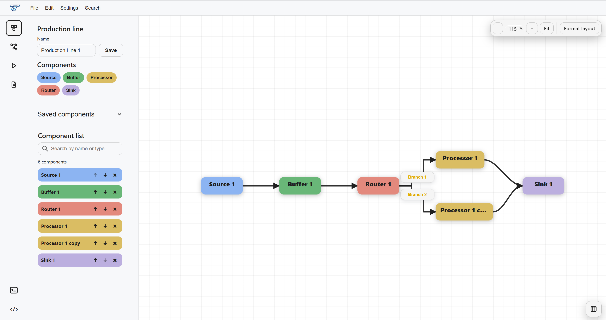
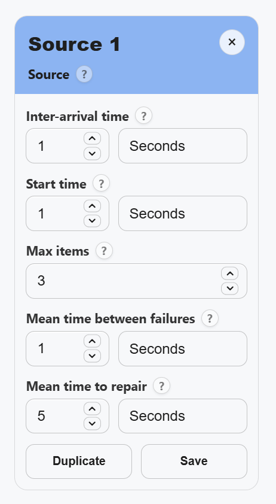
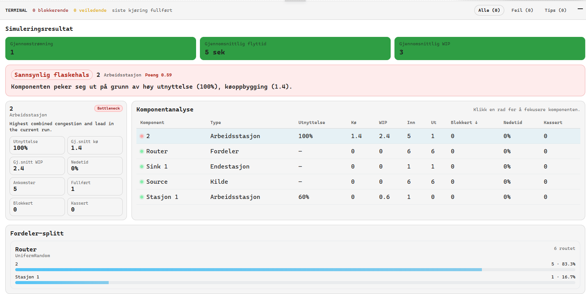

# Production Line Simulator

### Model production flows. Explore bottlenecks. Evaluate changes.

Bachelor’s thesis at **OsloMet** · In collaboration with **Goodtech ASA** · Spring 2026

**React · TypeScript · SVG · ASP.NET Core · PostgreSQL**

[Overview](#overview) · [Screenshots](#screenshots) · [My contribution](#my-contribution) · [Technical approach](#technical-approach)

## Overview

What happens to a production line when a workstation slows down, a buffer fills up, or work is routed differently?

We built a web-based discrete-event simulator to explore these questions. Users can model a production line, configure its components, and run simulations to investigate flow, queues, and potential bottlenecks before considering physical changes.

The project was developed by a five-person team in collaboration with **Goodtech ASA** as our bachelor’s thesis in Applied Computer Technology at OsloMet. I led the team and worked on frontend development.

## From model to insight

1. **Build a production line** by placing and connecting sources, buffers, workstations, routers, and sinks.
2. **Configure its behaviour** through processing times, capacity, queue limits, routing, and reliability parameters.
3. **Run a simulation** with a chosen duration and simulation settings.
4. **Investigate the results** through production KPIs and component-level statistics, then adjust the model to explore another scenario.

## Screenshots

### Visual production line modelling

The model builder above uses an SVG-based workspace to represent production flow as connected components. Users can arrange the layout, create connections, and edit individual components through the surrounding panels.

### Component configuration

Each component has a configuration panel tailored to its role in the production line. This source panel controls arrivals, the maximum number of items, and reliability settings.

  

### Simulation results and bottleneck analysis

The results view brings together **throughput**, **average flow time**, and **average work in progress (WIP)**. Component statistics show utilization, queues, completed items, and downtime, helping users investigate where flow may be constrained.

*Original screenshots from our bachelor’s thesis. The model builder and configuration panel are shown in English; the results view is shown in Norwegian.*

## My contribution

**Project lead & frontend developer**

I combined project coordination with hands-on frontend development in our five-person team. My work focused on the web interface through which users build and interact with production models.

One of the most valuable parts of the project was connecting software development with an unfamiliar production domain: understanding the client’s needs, making complex concepts usable in a visual interface, and refining the solution through feedback.

## Technical approach

| Layer | Implementation |
| --- | --- |
| User interface | React, TypeScript, Vite, Tailwind CSS |
| Visual modelling | Custom SVG workspace with nodes and connections |
| Application state | React Context API and `useReducer` |
| API | ASP.NET Core Web API on .NET 8, REST and JSON |
| Persistence | PostgreSQL and Entity Framework Core |
| Testing | xUnit, Vitest, React Testing Library, Playwright |

The frontend represents a production line as a graph of components and connections. When the user starts a simulation, it sends the model and simulation settings to the backend. The backend validates the input, runs the discrete-event simulation, and returns results to the interface.

The simulation advances from event to event, handling queues, blocking, capacity constraints, and downtime. Validation in both the frontend and backend helps users identify invalid configurations.

## Development and validation

We developed the MVP iteratively with Goodtech through meetings, demonstrations, and feedback. Our workflow combined prototyping, a prioritized backlog in GitHub Projects, and parallel frontend and backend development.

Validation combined automated tests, manually calculated simulation scenarios, and user testing with Goodtech representatives. These activities helped us evaluate model behaviour and improve the interface.

## Project scope

This repository is a **portfolio presentation** containing documentation and screenshots. The complete application source is not included.

The simulator was developed as an **MVP for demonstration, learning, and scenario comparison**. It has not been fully validated for industrial use.

## Team and collaboration

Developed by a five-person student team at OsloMet, in collaboration with Goodtech ASA.

**University:** OsloMet – Oslo Metropolitan University  
**Industry collaborator:** Goodtech ASA  
**Thesis:** *Diskret hendelsesbasert simulering i produksjonslinjer*  
**Completed:** Spring 2026
